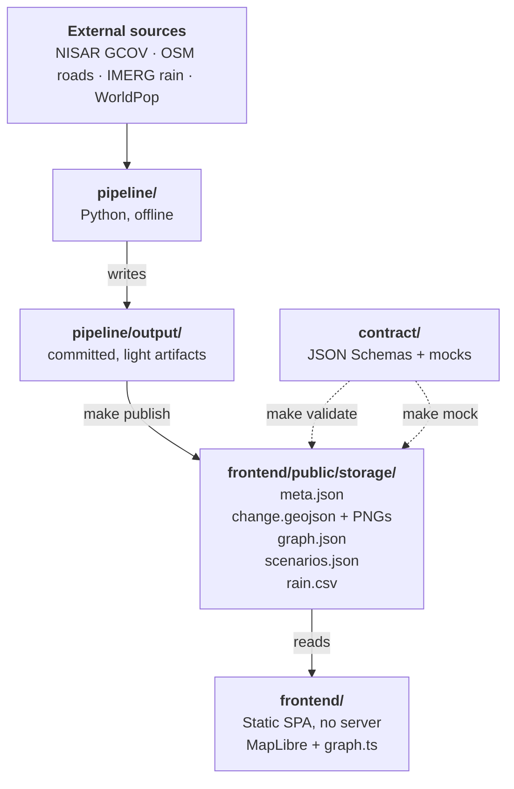

# VANTAGE — Structure

> Architecture and technical conventions for developers and coding agents.

## 1. Architecture



Two pieces, one coupling:

| Piece | Role |
|---|---|
| **Pipeline** (Python, offline) | Writes the data files |
| **SPA** (static, no server) | Only reads the files and runs the closure simulation in the browser |
| **Contract** | Defines the shape of the files; `make validate` checks the data folder against it |

The pipeline writes; the web reads. Neither imports the other.

## 2. Repository layout

One repo, `vantage`. README, Makefile and `.github/` live at the root (GitHub Actions requires `.github/` there). Everything else is under `projects/`.

```
vantage/
├── README.md
├── Makefile                 # make mock | make validate | make all
├── .github/
│   └── workflows/           # CI + GitHub Pages deploy
└── projects/
    ├── contract/
    │   ├── schemas/         # JSON Schemas (one per data file)
    │   └── examples/        # mock data that satisfies the schemas
    ├── pipeline/            # Python, managed with uv
    │   └── output/          # committed pipeline output (light artifacts only)
    └── frontend/            # Bun + strict TypeScript, React + Vite
        └── public/storage/  # git-ignored contract folder: copy of the mocks or of output/
```

The exact subfolders inside `pipeline/` and `frontend/source/` are not fixed. Propose them in a PR; do not assume them.

## 3. Data contract

`frontend/public/storage/` is the interface between both sides. Exact definitions live in `contract/schemas/`; the table is orientation only.

| File | Contents |
|---|---|
| `meta.json` | `schema_version`, sources, passes used (dates, track, direction, CRID) |
| `change.geojson` + overlay PNGs | Change polygons with ΔdB per zone, and the raster image for the map |
| `graph.json` | Road network (nodes and edges), hospitals, communities and travel times, so closures can be simulated in the browser |
| `scenarios.json` | Per candidate segment: extra time, dependent population, affected communities, rank |
| `rain.csv` | Date and daily IMERG rainfall |

### Rules

1. Schemas and mocks are written in hours 0–2 and then **frozen**. Every file carries `schema_version`.
2. The frontend works from minute one with `make mock`, which copies `contract/examples/` into `frontend/public/storage/`. When the pipeline produces real data (`make all`), it writes to `pipeline/output/` (committed), and `make publish` copies that into `storage/`; the web does not change. `storage/` is git-ignored.
3. `make validate` checks the data folder against the schemas (using `jsonschema` in Python). It runs in CI and before every deploy.
4. Changing a schema requires review by one backend and one frontend person, enforced with **CODEOWNERS**.
5. **Raw NISAR data is never committed**, only light artifacts. GitHub rejects files over 100 MB.

### Changing a data shape

In one PR: update the schema, update the mock, bump `schema_version`, update both producer and consumer, run `make validate`.

## 4. Pipeline (Python)

Runs offline and is deterministic. Managed with **uv**.

| Stage | Input | Output |
|---|---|---|
| Acquire | ASF catalog (`asf.search`, or `earthaccess`) | Clipped GCOV arrays for two compatible passes (stream and clip; never whole scenes) |
| Change detection | Two GCOV passes | ΔdB raster with speckle filtered, water and shadow masked, small blobs removed → change polygons + overlay PNG |
| Road graph | OSM corridor | Segment network, hospitals and communities → `graph.json` |
| Candidate segments | Change polygons + graph | Segments touching a change zone (with buffer) |
| Impact | Graph + candidates + population | Remove one candidate at a time and recompute shortest paths to the nearest hospital → extra time, dependent population, isolated communities, criticality ranking → `scenarios.json` |
| Rain context | IMERG Late daily | `rain.csv` |
| Export | All of the above | Files in `pipeline/output/`, then `make publish` and `make validate` |

### Constraints

- Same **track, direction and CRID** for both passes. Never mix.
- Pixel is 10 or 20 m depending on location; do not assume one resolution.
- Respect the data gap **Jul 27 – Aug 10** and the 12-day repeat.
- Provisional CRID `P05023` and validated `P05036` are never mixed in one comparison.
- IMERG Late (`GPM_3IMERGDL` V07): 0.1°, latency of at least 14 h.
- Population (WorldPop) may be unavailable; the pipeline must degrade to extra time plus the count of communities.
- OSM data requires ODbL attribution; carry it into `meta.json` and the UI footer.

## 5. Frontend (static SPA)

Stack: **Bun**, **strict TypeScript**, **React + Vite**, **MapLibre GL JS**, **Zustand**, **Recharts**, plus `graph.ts` for the client-side closure simulation.

- No server, no accounts. Contract files are fetched from `import.meta.env.BASE_URL`.
- **Map:** corridor, change layer (opacity control or before/after), candidate segments, hospitals, communities.
- **State (Zustand):** selected segment, set of closed segments, layer mode and opacity, selected passes.
- **`graph.ts`:** loads `graph.json`, runs the shortest path to the nearest hospital and recomputes when segments are closed. Runs fully in the browser.
- **Charts (Recharts):** daily rainfall from `rain.csv` for the "Why?" panel.
- Never hardcode numbers that come from the pipeline; read them from `scenarios.json` and `meta.json`.

### Design reference

Frontend prototypes (side-panel layout versus full-bleed map, closure simulation, "Why?" panel, mobile) live in the shared design canvas. The side-panel layout is recommended. Prototype numbers, dates and community names are **placeholders**, and the prototype map is schematic, not MapLibre.

## 6. Build, test, deploy

| Command | What it does |
|---|---|
| `make mock` | Copy `contract/examples/` → `frontend/public/storage/` |
| `make publish` | Copy `pipeline/output/` → `frontend/public/storage/` |
| `make validate` | Validate `frontend/public/storage/` against `contract/schemas/` |
| `make all` | Run the pipeline and regenerate every data file in `pipeline/output/` |
| `bun run build` (in `projects/frontend/`) | Build the SPA into `dist/` |

**Deployment:** GitHub Pages via GitHub Actions. The workflow runs `make publish` (or `make mock` until real data exists), `make validate`, then `bun run build` in `projects/frontend/`, then publishes `projects/frontend/dist`.

- Vite `base` must equal the repo name (exact name still to be set). Fetch data with `import.meta.env.BASE_URL`, otherwise Pages returns 404.
- Deploy a skeleton with mocks early and test on every deploy.
- Final release: tag `v1.0` with a zip of `dist/` for offline use. Test the published site in a private window and on a phone.

## 7. Workflow and conventions

- Short-lived branches, **squash merge to `main`**.
- Two-sided review (backend and frontend, via CODEOWNERS) only for contract changes.
- License: MIT for code; credit NASA and OpenStreetMap.
- Tooling: `uv` for Python; Bun with strict TypeScript for the frontend.
- Timeline gates (Costa Rica time): Sat 15:00 go/no-go on NISAR data, Sun 14:00 feature freeze, Sun 18:00 code freeze (bug fixes only).

## 8. Rules for coding agents

1. Stay within the contract. Do not make the frontend depend on pipeline internals, or the reverse.
2. Any change to a data file shape means schema, mock, `schema_version` and `make validate`, in one PR.
3. Do not commit raw NISAR data, large rasters or credentials (ASF and Earthdata tokens stay in environment variables).
4. Do not invent data. Unknown values stay pending or placeholders; never fabricate coordinates, populations, dates or closure events.
5. Keep user-facing language hedged: "candidate segment", "signal", "hypothesis". Never "confirmed" or "caused by".
6. Prefer cutting scope over breaking the demo. Do not add a backend, auth or other regions without a team decision.
7. Do not guess file layouts that are left open; propose them and ask.
