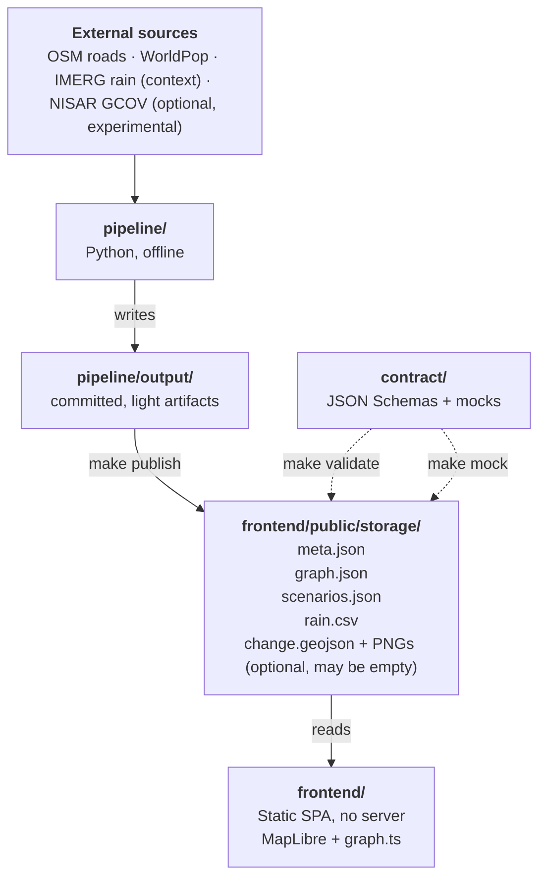

# VANTAGE — Structure

> Architecture and technical conventions for developers and coding agents.

## 1. Architecture



Two pieces, one coupling:

| Piece | Role |
|---|---|
| **Pipeline** (Python, offline) | Writes the data files |
| **SPA** (static, no server) | Only reads the files and runs the closure simulation in the browser |
| **Contract** | Defines the shape of the files; `make validate` checks the data folder against it |

The pipeline writes; the web reads. Neither imports the other.

## 2. Repository layout

One repo, `vantage`. README, Makefile and `.github/` live at the root (GitHub Actions requires `.github/` there). Everything else is under `projects/`.

```
vantage/
├── README.md
├── Makefile                 # make mock | make validate | make all
├── .github/
│   └── workflows/           # CI + GitHub Pages deploy
└── projects/
    ├── contract/
    │   ├── schemas/         # JSON Schemas (one per data file)
    │   └── examples/        # mock data that satisfies the schemas
    ├── pipeline/            # Python, managed with uv
    │   └── output/          # committed pipeline output (light artifacts only)
    └── frontend/            # Bun + strict TypeScript, React + Vite
        └── public/storage/  # git-ignored contract folder: copy of the mocks or of output/
```

The exact subfolders inside `pipeline/` and `frontend/source/` are not fixed. Propose them in a PR; do not assume them.

## 3. Data contract

`frontend/public/storage/` is the interface between both sides. Exact definitions live in `contract/schemas/`; the table is orientation only.

| File | Contents |
|---|---|
| `meta.json` | `schema_version` (0.2), `area` (name and bbox, a parameter), sources, `exposure_sources`, `detection_limits`; `passes` only if a change layer exists |
| `change.geojson` + overlay PNGs | **Optional.** Change polygons with ΔdB per zone and the raster image; the file may be an empty FeatureCollection and the PNGs may be absent |
| `graph.json` | Road network (nodes and edges), hospitals, communities and travel times, so closures can be simulated in the browser |
| `scenarios.json` | Per critical segment (key `candidates`): extra time, dependent population, affected communities, rank, `source`, `exposure` |
| `rain.csv` | Date and daily IMERG rainfall |

### Rules

1. Schemas and mocks were frozen at 0.1 and moved to 0.2 after G1 (`context/contracts.md` §12). Every file carries `schema_version`.
2. The frontend works from minute one with `make mock`, which copies `contract/examples/` into `frontend/public/storage/`. When the pipeline produces real data (`make all`), it writes to `pipeline/output/` (committed), and `make publish` copies that into `storage/`; the web does not change. `storage/` is git-ignored.
3. `make validate` checks the data folder against the schemas (using `jsonschema` in Python). It runs in CI and before every deploy.
4. **Raw NISAR data is never committed**, only light artifacts. GitHub rejects files over 100 MB.

### Changing a data shape

In one PR: update the schema, update the mock, bump `schema_version`, update both producer and consumer, run `make validate`.

## 4. Pipeline (Python)

Runs offline and is deterministic. Managed with **uv**.

**Zone is a parameter.** The analysis area (an area name or a bbox) comes from config and is written to `meta.json → area`; it is never fixed in code. Ruta 32 is the demonstration case. Config shape (proposed, not built yet):

```toml
[area]
name = "Ruta 32 corridor"        # shown in the UI and meta.json
bbox = [-84.20, 9.95, -83.70, 10.30]   # [w, s, e, n], placeholder values
referral_hospitals = []                # OSM ids (way/…); for Ruta 32: Calderón Guardia, México, San Juan de Dios (ids pending, Ian)
```

| Stage | Input | Output |
|---|---|---|
| Road graph | OSM for the configured area | Segment network, hospitals and communities → `graph.json` |
| Impact (consequence) | Graph + population | Remove one segment at a time (both carriageways) and recompute shortest paths to the nearest referral hospital → extra time, dependent population, isolated communities, criticality ranking → `scenarios.json` |
| Exposure layer | IMERG Late daily | `rain.csv`, and per-segment `exposure` in `scenarios.json` (`rain_mm_12d`; `soil_moisture_pctl` stays `null`; `radar_evidence`) |
| Change detection (optional, experimental) | Two GCOV passes | ΔdB change polygons + overlay PNG. At landslide scale the test was negative (`approach.md` §5), so this stage may produce an empty layer. Not a generator of critical segments |
| Export | All of the above | Files in `pipeline/output/`, then `make publish` and `make validate` |

### Constraints

- Population (WorldPop) may be unavailable or not yet joined; the pipeline must degrade to extra time plus the count of communities.
- IMERG Late (`GPM_3IMERGDL` V07): 0.1°, latency of at least 14 h.
- For the optional radar stages: same **track, direction and CRID** for both passes, never mix provisional `P05023` and validated `P05036`; pixel is 10 or 20 m; respect the data gap **Jul 27 – Aug 10** and the 12-day repeat; stream and clip, never whole scenes.
- OSM data requires ODbL attribution; carry it into `meta.json` and the UI footer.
- Closures remove **both carriageways** of Ruta 32 (87 % of its OSM edges are one-way pairs), and communities and hospitals snap to the largest strongly connected component of the directed graph (D8). Neither is in the P3 and P5 specs yet.
- Generalization: designed for corridors with an OSM road network, not tested outside Ruta 32. Known limits: OSM quality, hospital registration, the choice of referral hospitals for each area.

## 5. Frontend (static SPA)

Stack: **Bun**, **strict TypeScript**, **React + Vite**, **MapLibre GL JS**, **Zustand**, **Recharts**, plus `graph.ts` for the client-side closure simulation.

- No server, no accounts. Contract files are fetched from `import.meta.env.BASE_URL`.
- **Map:** corridor, critical segments, hospitals, communities; the change layer (opacity control) only when it exists.
- **State (Zustand):** selected segment, set of closed segments, and layer mode, opacity and selected passes when a change layer exists.
- **`graph.ts`:** loads `graph.json`, runs the shortest path to the nearest hospital in `graph.json` (the referral hospitals, D8) and recomputes when segments are closed. Runs fully in the browser.
- **Charts (Recharts):** daily rainfall from `rain.csv` for the "Why?" (exposure) panel.
- Never hardcode numbers that come from the pipeline; read them from `scenarios.json` and `meta.json`.

### Design reference

Frontend prototypes (side-panel layout versus full-bleed map, closure simulation, "Why?" panel, mobile) live in the shared design canvas. The side-panel layout is recommended. Prototype numbers, dates and community names are **placeholders**, and the prototype map is schematic, not MapLibre.

## 6. Build, test, deploy

| Command | What it does |
|---|---|
| `make mock` | Copy `contract/examples/` → `frontend/public/storage/` |
| `make publish` | Copy `pipeline/output/` → `frontend/public/storage/` |
| `make validate` | Validate `frontend/public/storage/` against `contract/schemas/` |
| `make all` | Run the pipeline and regenerate every data file in `pipeline/output/` |
| `bun run build` (in `projects/frontend/`) | Build the SPA into `dist/` |

**Deployment:** GitHub Pages via GitHub Actions. The workflow runs `make publish` (or `make mock` until real data exists), `make validate`, then `bun run build` in `projects/frontend/`, then publishes `projects/frontend/dist`.

- Vite `base` must equal the repo name (exact name still to be set). Fetch data with `import.meta.env.BASE_URL`, otherwise Pages returns 404.
- Deploy a skeleton with mocks early and test on every deploy.
- Final release: tag `v1.0` with a zip of `dist/` for offline use. Test the published site in a private window and on a phone.

## 7. Workflow and conventions

- Short-lived branches, **squash merge to `main`**.
- License: MIT for code; credit NASA and OpenStreetMap.
- Tooling: `uv` for Python; Bun with strict TypeScript for the frontend.
- Timeline gates (Costa Rica time): Sat 15:00 go/no-go on NISAR data, Sun 14:00 feature freeze, Sun 18:00 code freeze (bug fixes only).

## 8. Rules for coding agents

1. Stay within the contract. Do not make the frontend depend on pipeline internals, or the reverse.
2. Any change to a data file shape means schema, mock, `schema_version` and `make validate`, in one PR.
3. Do not commit raw NISAR data, large rasters or credentials (ASF and Earthdata tokens stay in environment variables).
4. Do not invent data. Unknown values stay pending or placeholders; never fabricate coordinates, populations, dates or closure events.
5. **No fixed data as a seed.** Never use the Lanamme sites, MOPT kilometres or press coordinates to decide which segments or places matter. Press dates are validation labels only.
6. Radar detection is optional and experimental. Do not build features that assume a change layer exists; handle an empty or absent one.
7. The analysis area is a config parameter, not a constant in code.
8. Keep user-facing language hedged: "critical segment" (*tramo crítico*), "signal", "hypothesis". Never "confirmed" or "caused by". Never "works anywhere".
9. Prefer cutting scope over breaking the demo. Do not add a backend, auth or other regions without a team decision.
10. Do not guess file layouts that are left open; propose them and ask.
